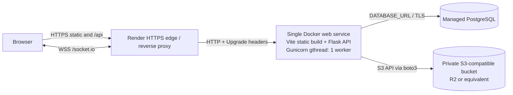

# midnight. Production Architecture Review

Review date: 2026-11-07. Hosting plans and prices change; use the linked provider
pages to confirm the selected region, current plan, database retention, backups,
bandwidth, and storage charges immediately before deployment.

## Current application

- React 19, Vite, React Router, Axios, Tailwind CSS, and Socket.IO client.
- Flask application factory with SQLAlchemy, Flask-Migrate/Alembic, PostgreSQL,
  JWT authentication, Google OAuth verification, and Flask-SocketIO.
- The API uses `/api`; Vite proxies API and Socket.IO only during local development.
- Socket.IO runs in `threading` mode. Connect handlers validate JWTs; conversation
  joins and sends verify membership. Reconnecting clients reload history.
- Post attachments and avatars used local files. Local disk is ephemeral on many
  hosts, so the production image selects private S3-compatible storage. Existing
  files are not migrated by this change.
- JWTs are held in `localStorage`. This is vulnerable to token theft after an XSS
  flaw. A future migration can use short-lived access tokens held in memory and
  rotating refresh tokens in `HttpOnly`, `Secure`, `SameSite` cookies, with CSRF
  protections and an explicit token-revocation strategy. That changes auth flows
  and needs a separate compatibility plan; this stage preserves current behavior.

## Recommended portfolio deployment

Use a single Render Docker web service to serve the built React app and Flask
API from one HTTPS origin, Render managed PostgreSQL, and a private Cloudflare R2
bucket (or another S3-compatible provider) for post media and avatars. The app
origin keeps API, static media routes, and Socket.IO same-origin. The platform
edge terminates TLS and forwards HTTP plus WebSocket upgrades to the Gunicorn
port. The app currently runs one Gunicorn worker per instance, so one instance
is the supported topology. Render documents public WebSocket support and that
web services have ephemeral filesystems by default; a disk is attached to an
individual instance. The object bucket is the persistent file store.

The app enforces existing author and draft-media privacy checks before it reads
an object. S3 access is server-side using the AWS SDK credential chain; the
bucket must not have public-read access. Video/audio response streaming supports
HTTP byte ranges. The S3 adapter stages deletes with a temporary private object
so failed database deletion can restore the original. New uploads use the
selected backend. **Do not switch a live installation from local storage to S3
until all existing post media and avatars have been migrated and verified.**
This stage does not migrate, copy, or delete any existing file.

### Socket.IO topology

The production config uses Gunicorn `gthread`, one worker, 100 threads by
default, and `simple-websocket`, matching Flask-SocketIO's documented threaded
deployment. Keep `/socket.io` WebSocket upgrade and connection headers enabled at
the edge. The client reconnects and reloads message history after a disconnect.
The current server does not configure a Socket.IO message queue or shared room
manager; do not scale to multiple app instances until Redis-backed Socket.IO
broadcasting and the platform's session/load-balancing requirements are added
and verified. The auth limiter is process-local with `memory://` by default;
configure a shared Redis URI before running multiple instances.

### Migration and release approach

Do not run Alembic as an application import or startup side effect. Take a
database backup, inspect `flask db history` and the target revision, then run
`python -m flask --app run db upgrade` once as a release command against the
target database. Run `flask db check` after upgrade. Do not use `db reset`, drop
the database, or point tests at production. The deployment image does not
include uploaded local files.

## Host comparison

| Option | Fit for this stack | Persistent files and Socket.IO | Cost/operations notes |
| --- | --- | --- | --- |
| **Render (recommended)** | Docker web service supports this Python app; managed PostgreSQL is available. | Web services accept WebSockets. Default filesystem is ephemeral; use the S3-compatible bucket. A persistent disk is possible but is instance-local and not the preferred upload store. | Lowest operational burden here: platform deploys, TLS, logs, managed DB, and a single combined app container. Paid service and database/storage totals must be checked. Free services idle down; free Postgres has a 30-day limit and is not for production. |
| **Railway** | Can run the same Docker image and PostgreSQL service. | Use external S3-compatible object storage. Confirm WebSocket behavior and proxy settings in the current service docs before selecting a plan. | Usage-based compute, memory, storage, and egress plus a plan subscription; bill depends on use. Convenient deploy flow, but avoid assuming a free tier is durable production. |
| **Fly.io** | Runs the Docker image as Machines. | WebSockets work through the app service; use an object store rather than instance volumes for user uploads. Managed Postgres is available. | More platform configuration than Render. Current Fly pricing lists Managed Postgres starting at $38/month before provisioned storage; compute, volumes, and egress add cost. This fixed database cost is less attractive for a small portfolio app. |
| **VPS (for example, DigitalOcean)** | Caddy/Nginx can serve SPA files and proxy `/api` and `/socket.io` to Gunicorn. PostgreSQL may be managed separately. | Keep media in private S3-compatible storage; local VPS disks need backups and do not provide a safe multi-instance media layer. Reverse proxy must support WebSocket upgrades. | VM sticker price can be low, but operators own OS updates, firewall, TLS, logs, backups, monitoring, and recovery. Better when server administration is part of the learning goal. |

Official references checked on the review date:

- [Render WebSockets](https://render.com/docs/websocket), [Render persistent disks](https://render.com/docs/disks), [Render free-tier limits](https://render.com/docs/free), [Render pricing](https://render.com/pricing).
- [Railway pricing](https://docs.railway.com/pricing) and [plans](https://docs.railway.com/pricing/plans).
- [Fly.io pricing](https://fly.io/pricing/), [Managed Postgres](https://www.fly.io/docs/mpg/), and [resource pricing details](https://www.fly.io/docs/about/pricing/).
- [DigitalOcean Droplet pricing](https://www.digitalocean.com/pricing/droplets).
- [Cloudflare R2 pricing](https://developers.cloudflare.com/r2/pricing/) and [S3 compatibility](https://developers.cloudflare.com/r2/how-r2-works/).
- [Flask-SocketIO deployment guidance](https://flask-socketio.readthedocs.io/en/stable/deployment.html).

R2 pricing currently lists a standard storage allowance and no egress fee, but
operation volume, storage class, account terms, and provider terms must still be
reviewed. No provider account was created and no deployment or purchase was
made.
